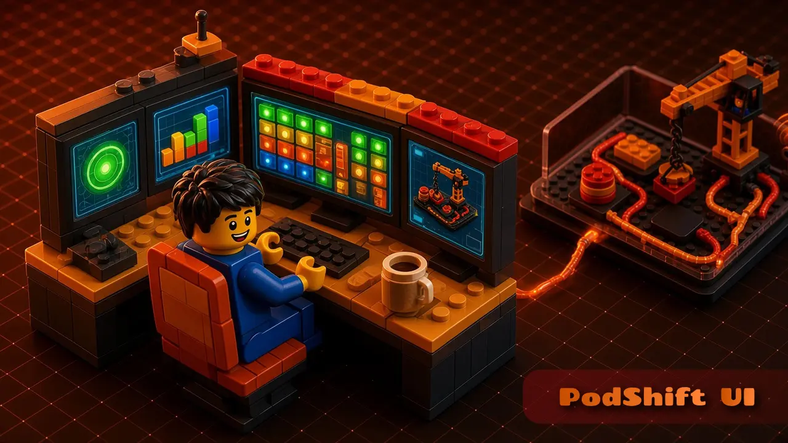

# PodShift UI

English | [Suomi](readme.fi.md)

PodShift UI (`cockpit-podshift`) is a [Cockpit](https://cockpit-project.org/) add-on for [PodShift](https://github.com/vellamo-dev/podshift). It adds a PodShift page to Cockpit, where you can see what is on the server.

PodShift is a lightweight container orchestration enabler for small servers: it turns a server into one that sets itself up, keeps itself secure, and updates your apps automatically.

## Features

PodShift UI is the optional Cockpit page for your PodShift server. You can look around, copy what you see, and carry out a few everyday tasks, such as setting the environment, adding a configuration variable, or installing and uninstalling an app.

A Quadlet is a small recipe file that describes an app, a volume, a network or similar, so PodShift can install and run it.

The tabs appear in the order below. A tab, or a single action, is hidden when the installed PodShift does not offer it. Use Refresh in the header to reload the current tab. On Overview, Drop Quadlet, Containers, Volumes, Networks and Quadlets, an Auto refresh switch sits beside it.

### Overview

Your server's health and setup in a single glance.

- The page holds Status, Usage, Info, Configuration and Health cards. A card is left out if PodShift cannot provide it.
- Copy, in each card's menu, copies that card as text.
- The Usage figures are links that open the matching tab.
- Some Status and Info lines open the related service, either in this UI or in Cockpit's Services page.
- The Health card summarises the last check. View report in its menu, or View details when something is wrong, opens the Health tab.
- If the environment is not set, a warning appears under the tabs. On the Configuration card, the Not set value opens a short form to set it once, with suggested tags.
- Add variable, in the Configuration card's menu, adds a custom setting. Click an existing custom value to change or remove it. Removal asks for confirmation first.
- Network settings, and an environment tag that is already set, cannot be changed here.

### Drop Quadlet

Install a new app by dropping its recipe file onto the page.

- Drag a Quadlet file or a zip onto the drop area, or choose one with Browse. One file at a time, at most 50 KB: `.container`, `.volume`, `.network`, `.image` or `.zip`.
- After a drop, the area is locked briefly so a second file is not added too soon.
- Drop History shows what was accepted, installed, refused or already present.
- The Install log shows progress, including uninstalls started from other tabs.
- In the install log's menu you can choose Newest first or Oldest first, and Copy log copies the lines you see.
- Auto refresh stays on while you watch a drop or an uninstall finish.

### Health

A full health check, grouped so you can see what is well and what needs a closer look.

- Opening the tab, or using Refresh, runs a fresh check. The last result stays on screen while it runs.
- Each group lists the individual checks, with a short hint when something can be put right.
- Copy, in the report's menu, copies the whole report as text.

### Containers

Your running apps, each on its own card.

- Filter by name or image, and switch the source: Quadlet, Unit, or created by hand.
- Each card shows its state, and an auto-update mark when that is set.
- From the card's menu: Copy, Inspect, Variables and Commands.
- Inspect shows the full details, which you can copy or download.
- Variables lists the container's environment. Secret values stay hidden until you choose Show secrets. You can copy the list.
- Commands gathers ready-to-copy terminal, log, process and system commands. This page never runs them. Copy a single command, or copy or download the whole page as Markdown.
- If the container was made by an installed Quadlet, Show Quadlet and Uninstall appear in the menu. Uninstall asks for confirmation first, and can keep or delete volume data.
- Show in Podman UI opens Cockpit's Podman page, when that package is installed.
- Auto refresh is off until you turn it on, or until an uninstall is queued.

### Volumes

Storage for your apps, each on its own card.

- Filter by name or mount point, and switch the source.
- From the card's menu: Copy and Inspect. Inspect lets you copy or download the details.
- A volume made by an installed Quadlet can be uninstalled from the card's menu, with the same choice to keep or delete volume data.
- Auto refresh is off until you turn it on, or until an uninstall is queued.

### Networks

The networks your apps share, each on its own card.

- Filter by name, and switch the source, including built-in networks.
- From the card's menu: Copy and Inspect. Inspect lets you copy or download the details.
- A network made by an installed Quadlet can be uninstalled from the card's menu.
- Auto refresh is off until you turn it on, or until an uninstall is queued.

### Images

The container images on the server, each on its own card.

- Filter by name, address or tags, and switch the source.
- From the card's menu: Copy and Inspect. Inspect lets you copy or download the details.
- Show Quadlet appears when the image is tied to a Quadlet service.
- Show in Podman UI opens Cockpit's Podman page, when that package is installed.
- There is no Auto refresh switch on this tab. Use Refresh in the header.

### Secrets

Passwords and other secrets your apps use, each on its own card. The cards themselves do not show the secret values.

- Filter by name, and switch between All, In use and Unused.
- From the card's menu: Copy and Inspect. Inspect shows the details, not the secret value. You can copy or download them.
- There is no Auto refresh switch on this tab. Use Refresh in the header.

### Services

The background services of the podshift user, each on its own card.

- Filter by name, and switch the state: Active, Inactive or Failed.
- From the card's menu: Copy, Show Unit, Show status, Show log, and Open log.
- Show Unit opens the unit file, which you can copy or download. If the service came from a Quadlet, you can switch to that recipe in the same view, or choose Show Quadlet from the menu.
- Show status shows the current status as text you can copy.
- Show log shows recent log lines, which you can copy or refresh. Open log, in the menu or in that view, opens Cockpit's Logs page for the unit.
- There is no Auto refresh switch on this tab. Use Refresh in the header.

### Quadlets

The installed recipes that describe your apps.

- Filter by name, and switch the state or the type, such as container, volume or network.
- A card shows the description when the recipe has one, and the app name when it is part of a bundle.
- From the card's menu: Copy, and Uninstall when PodShift offers it. Uninstall asks for confirmation, and can keep or delete volume data when that applies.
- For a recipe that has a service, Show Quadlet and Show Unit open the recipe or the unit file, which you can copy or download, and switch between the two views in the same window.
- Auto refresh is off until you turn it on, or until an uninstall is queued.

## PodShift does not need the UI

PodShift works fully without the UI. All monitoring and management is done with the `podshift` commands in a terminal.

The UI is optional. It makes monitoring and some maintenance tasks easier for people who prefer a web interface over the terminal. It needs PodShift installed on the same host, but the `cockpit-podshift` package does not install PodShift for you.

## Install

Install [PodShift](https://github.com/vellamo-dev/podshift) first. Then open **Applications** in Cockpit and install PodShift UI from there. When it is installed, choose **PodShift** in the Cockpit menu.

Other install methods, updates and removal are described in [docs/usage.md](docs/usage.md). A longer overview of the pages and access rules is in [docs/readme.md](docs/readme.md). The security policy is in [security.md](security.md).

## Licence

This project is based on the [Cockpit starter kit](https://github.com/cockpit-project/starter-kit). New project files are licensed under AGPL-3.0-or-later; see `LICENSE`. Two files that still contain a substantial share of original starter-kit or Cockpit code remain under LGPL-2.1-or-later; see [docs/licenses/](docs/licenses/).
